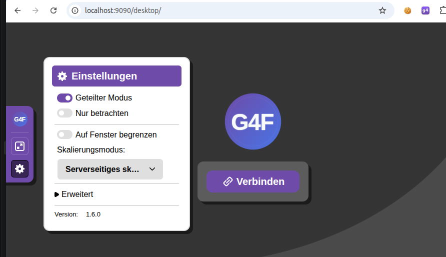
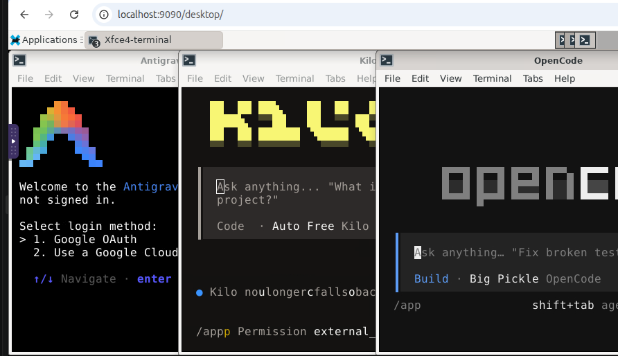
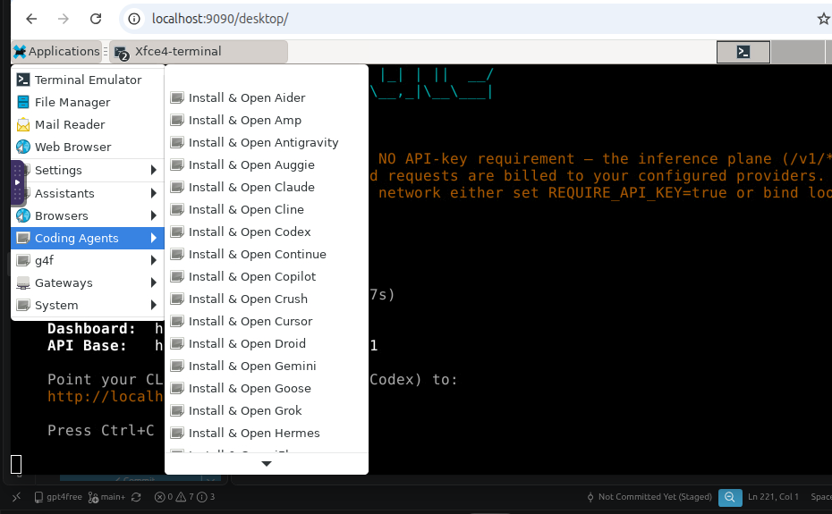

# Sandbox desktop menu — install & open desktop tools





Entries behind the sandbox desktop's **Applications** menu
(`docker/Dockerfile-sandbox-desktop`), grouped into eight top-level menus —
**g4f**, **Browsers**, **Coding Agents**, **Gateways**, **Local AI**,
**Chat UIs**, **Editors** and **Assistants** — instead of one flat list under
Development.
Each **Install & Open …** item opens a terminal maximized to the sandbox
screen, without window borders or menubar:

```
xfce4-terminal --maximize --hide-borders --hide-menubar --icon=g4f-sandbox-<tool> --command="/usr/local/bin/sandbox-cli <tool>"
```

A multi-word `--title` must be quoted (`--title="Sandbox Settings"`): the
desktop-entry `Exec` line is split on whitespace, so an unquoted title makes
xfce4-terminal treat the second word as an option and refuse to start
(`Unknown option "Settings"`).

`sandbox-cli` installs tools on **first click** — a vendor install script,
an npm package, a `pip install --user`, or Google's Chrome `.deb` — then runs
them in that same terminal (Chrome opens on the desktop instead). The
 CLI is preinstalled in the image. Node.js 24 and  are also
preinstalled (from the official  image) for the npm-based tools; the rest is installed on demand.



| Menu entry               | Tool id     | Install recipe              | Binary         |
|--------------------------|-------------|-----------------------------|----------------|
| Install & Open OpenCode  | `opencode`  | opencode.ai v2 install script | `opencode`     |
| Install & Open Kilo      | `kilocode`  | npm `@kilocode/cli`         | `kilo`         |
| Install & Open Antigravity | `antigravity` | antigravity.google install script | `agy`    |
| Install & Open Gemini    | `gemini-cli`| npm `@google/gemini-cli`    | `gemini`       |
| Install & Open Qwen      | `qwencode`  | npm `@qwen-code/qwen-code`  | `qwen`         |
| Install & Open Claude    | `claude-code`| npm `@anthropic-ai/claude-code` | `claude`   |
| Install & Open Codex     | `codex`     | npm `@openai/codex`         | `codex`        |
| Install & Open Copilot   | `copilot`   | npm `@github/copilot`       | `copilot`      |
| Open g4f-go CLI          | `g4f-go`    | preinstalled in the image   | `g4f-go`       |
| Open Remote Desktop      | `remote-desktop` | g4f-go bundled module + pip `qrcode`, `python-xlib`, `pynput` | `g4f-go` |
| Sandbox Settings         | `settings`  | none (writes a settings file) | —            |
| Reset Sandbox Settings   | `reset`     | none (removes the settings file) | —         |
| Public URLs              | `urls`      | none (prints the g4f API URLs) | —           |
| Install & Open Cline     | `cline`     | npm `cline`                 | `cline`        |
| Install & Open Amp       | `amp`       | npm `@ampcode/cli`          | `amp`          |
| Install & Open Goose     | `goose`     | block/goose install script  | `goose`        |
| Install & Open Aider     | `aider`     | pip `aider-chat` (user)     | `aider`        |
| Install & Open Cursor    | `cursor`    | cursor.com/install script   | `cursor-agent` |
| Install & Open Chrome    | `chrome`    | Google's Chrome `.deb` (apt)| `start-browser` |
| Install & Run Lightpanda | `lightpanda`| `g4f-go browser install`    | `g4f-go`       |
| Install & Open OmniRoute | `omniroute` | npm `omniroute`             | `omniroute`    |
| Install & Open Ollama    | `ollama`    | ollama.com install script   | `ollama`       |
| Install & Open llama.cpp | `llamacpp`  | GitHub release tarball      | `llama-server` |
| Install & Open LM Studio | `lmstudio`  | lmstudio.ai install script  | `lms`          |
| Install & Open Jan       | `jan`       | GitHub release AppImage     | `jan`          |
| Install & Open LibreChat | `librechat` | git clone + `npm run reinstall` + MongoDB | `npm` |
| Install & Open LobeChat  | `lobechat`  | GitHub release AppImage     | `lobechat`     |
| Install & Open Msty Studio | `msty`    | vendor "latest" AppImage    | `msty`         |
| Install & Open SillyTavern | `sillytavern` | git clone + `npm install` | `node`       |
| Install & Open Open WebUI Computer | `cptr` | pip `cptr` (user)     | `cptr`         |
| Install & Open VS Code Web | `code-server` | code-server.dev install script | `code-server` |
| Install & Open OpenClaw  | `openclaw`  | openclaw.ai install script  | `openclaw`     |
| Install & Open Crush     | `crush`     | npm `@charmland/crush`      | `crush`        |
| Install & Open Continue  | `continue-cli` | npm `@continuedev/cli`   | `cn`           |
| Install & Open Grok      | `grok`      | x.ai/cli install script     | `grok`         |
| Install & Open Droid     | `droid`     | app.factory.ai/cli script   | `droid`        |
| Install & Open OpenHands | `openhands` | install.openhands.dev script| `openhands`    |
| Install & Open gptme     | `gptme`     | pip `gptme`                 | `gptme`        |
| Install & Open Plandex   | `plandex`   | plandex.ai install script   | `plandex`      |
| Install & Open Hermes    | `hermes`    | hermes-agent.nousresearch.com script | `hermes` |
| Install & Open Kiro      | `kiro`      | cli.kiro.dev install script | `kiro-cli`     |
| Install & Open Kimi      | `kimi`      | code.kimi.com install script| `kimi`         |
| Install & Open Roomote   | `roomote`   | get.roomote.dev install script | `roomote`      |
| Install & Open Auggie    | `auggie`    | npm `@augmentcode/auggie`   | `auggie`       |
| Install & Open Qoder     | `qoder`     | qoder.com install script    | `qodercli`     |
| Install & Open iFlow     | `iflow`     | npm `@iflow-ai/iflow-cli`   | `iflow`        |
| Install & Open Mistral Vibe | `vibe`   | mistral.ai/vibe install script | `vibe`      |
| Install & Open SWE-agent | `sweagent`  | uv tool `--editable` clone of SWE-agent (Python 3.13) | `sweagent` |
| Install & Open Fabric    | `fabric`    | fabric installer script     | `fabric`       |
| Install & Open LiteLLM   | `litellm`   | pip `litellm[proxy]`        | `litellm`      |
| Install & Run Proxy Server | `proxy`   | pip `mitmproxy`             | `mitmproxy`    |
| Install & Run Tunnel Client | `tunnel` | GitHub release `cloudflared` | `cloudflared`  |
| Install & Open ShellGPT  | `sgpt`      | pip `shell-gpt`             | `sgpt`         |
| Install & Open LLM CLI   | `llm`       | pip `llm`                   | `llm`          |
| Install assistant-ui     | `assistant-ui` | npx `setup-agent` (no install) | `npx`      |

Beyond the coding agents, the menu also carries **gateways** (`omniroute`,
`litellm`) that expose an OpenAI-compatible endpoint, together with a
debugging **proxy server** (`proxy`, mitmproxy) and a **tunnel** entry
(`tunnel`, Cloudflare's cloudflared) that publishes a local port on a
public HTTPS URL, **local AI** runtimes
(`ollama`, `llamacpp`, `lmstudio`, `jan`) that serve models on
the machine itself, **chat UIs** (`librechat`, `lobechat`, `msty`,
`sillytavern`, `cptr`) that put a chat front end on top of the g4f API,
a browser **editor** (`code-server`, VS Code Web served by code-server),
and **assistant/agent CLIs**
(`openclaw`, `fabric`, `sgpt`, `gptme`, `llm`) that live in the terminal.
Install scripts land their
binary in `~/.local/bin`, `~/.kimi-code/bin`, `~/.qoder/bin`,
`~/.lmstudio/bin` or `/usr/local/bin`, all on `sandbox-cli`'s `PATH`.

Two installers need a package the image does not ship, so `sandbox-cli` pulls
it in on first click: **Hermes** clones its own checkout and therefore needs
`git` (`ensure_git`), and **Kiro CLI** unpacks a `.zip` and therefore needs
`unzip` (`ensure_unzip`). Hermes installs into
`~/.hermes/hermes-agent/.hermes/bin` and only adds `~/.local/bin` to the shell
rc, so `ensure_hermes` symlinks `hermes` into `~/.local/bin` itself. It runs
with `--non-interactive`, which skips the interactive `setup`/`gateway`
stages. The launcher points Hermes at the g4f API when a model has been chosen
in **Sandbox Settings**; otherwise run `hermes setup` in the terminal to
configure a provider by hand.

**SWE-agent** installs through **uv** instead of pip (`ensure_sweagent`),
because the image's embedded CPython is 3.15 and SWE-agent's pinned
dependencies ship no wheels for it. `ensure_uv` installs uv from astral.sh on
first click; `uv tool install --editable --python 3.13` then downloads a
matching CPython and links the binary into `~/.local/bin`. The install is
*editable* on purpose: SWE-agent asserts at import time that its `config/`,
`tools/` and `trajectories/` directories sit next to the package, but its wheel
does not carry them, so a plain `uv tool install` of the git checkout produces
a binary that crashes on start. `ensure_sweagent` therefore clones the repo
into `~/.swe-agent` (via `ensure_git`) and installs from that checkout.
SWE-agent additionally needs Docker at run time for its sandboxed
environments.

**Roomote** is the one entry that is not a CLI: `get.roomote.dev` is a host
installer that runs as root, installs Docker when it is missing, writes
`/opt/roomote` and starts a Compose stack from published GHCR images, leaving
the `roomote` management CLI in `/usr/local/bin`. `ensure_roomote` pipes it
through `as_root` with `--tls-mode internal`, so Caddy serves a self-signed
certificate and the install needs no public DNS or ACME round trip. The image
has no init system, so the systemd unit the installer writes is inert here and
the stack is started directly; the menu entry prints the first-admin `/setup`
link (`roomote setup-url`) and then follows the service logs.

**assistant-ui** is the one entry that installs nothing: it runs
`npx setup-agent https://setup.assistant-ui.com/Q2Exyx6AidfK`, a thin Statewire
client whose setup is shared live between the browser that opened the URL and
the coding agent installing the products. The CLI prints the setup's
instructions and current state, then the agent drives it from the same shell
(`stream`, `wait start`, `plan`, `add-step`, `step`, `done`). It is meant for a
coding agent, so when none is detected it offers to start one — which is why
the entry opens a terminal rather than installing a binary. The URL is the
browser's link to its agent, not one setup: a finished setup stays on it and
the browser's next one replaces it. `sandbox-cli install assistant-ui` only
checks that `npx` is available.

### Categories

Each `.desktop` file carries `Categories=X-G4F-Sandbox;X-G4F-<Cat>;` instead of
`Development;`, and one top-level menu per category includes it:


| Menu             | Category          | Entries                                        |
|------------------|-------------------|------------------------------------------------|
| **g4f**          | `X-G4F-Core`      | `remote-desktop`, `g4f-go`, `settings`, `reset` |
| **Browsers**     | `X-G4F-Browser`   | `chrome`, `lightpanda`                         |
| **Coding Agents**| `X-G4F-Agent`     | `opencode`, `kilocode`, `antigravity`, `gemini-cli`, `qwencode`, `claude-code`, `codex`, `copilot`, `cline`, `amp`, `goose`, `aider`, `cursor`, `crush`, `continue-cli`, `grok`, `droid`, `openhands`, `plandex`, `hermes`, `kiro`, `kimi`, `roomote`, `auggie`, `qoder`, `iflow`, `vibe`, `sweagent` |
| **Gateways**     | `X-G4F-Gateway`   | `omniroute`, `litellm`, `proxy`, `tunnel`      |
| **Local AI**     | `X-G4F-LocalAI`   | `ollama`, `llamacpp`, `lmstudio`, `jan` |
| **Chat UIs**     | `X-G4F-ChatUI`    | `librechat`, `lobechat`, `msty`, `sillytavern`, `cptr` |
| **Editors**      | `X-G4F-Editor`    | `code-server` |
| **Assistants**   | `X-G4F-Assistant` | `openclaw`, `fabric`, `sgpt`, `gptme`, `llm`, `assistant-ui` |

The menus are declared by patching the stock
`/etc/xdg/menus/xfce-applications.menu` at build time
(`patch-xfce-menu.py`), which inserts the eight `<Menu>` blocks just before its
`<DefaultMergeDirs/>` node. Shipping them as a merged menu file under
`/etc/xdg/menus/applications-merged/` does **not** work: garcon copies a merged
file's elements with `g_node_traverse(..., depth=2, G_IN_ORDER)`, which never
descends to the nested `<Menu>` nodes, so the menus are silently dropped and
every entry falls through to the catch-all **Other** menu. The patch script is
idempotent, so re-running it is a no-op.

The menu titles and icons come from the `.directory` files in
`desktop-directories/`, copied to `/usr/share/desktop-directories/`.

### Entry icons

Every entry names its own icon and hands the same name to the terminal, so the
menu row and the window it opens carry the same mark:

```
Exec=xfce4-terminal ... --title=Aider --icon=g4f-sandbox-aider --command="/usr/local/bin/sandbox-cli aider"
Icon=g4f-sandbox-aider
```

`fetch-icons.py` materializes those names in the hicolor theme at build time,
pulling each mark from the tool's own site — a direct logo asset where the
vendor publishes one, otherwise its favicon, otherwise its GitHub avatar. It
runs after the Pillow install because GTK icon themes load only `png`, `svg`
and `xpm`, so the JPEG sources (GitHub avatars, some favicons) are converted to
128x128 PNGs; SVGs are kept as SVG but rejected when they are not roughly
square, which is what keeps wordmarks such as aider.chat's 200x60 logo out.
`gtk-update-icon-cache` then refreshes the hicolor cache.

A tool whose sources are all unreachable falls back to the shared
`g4f-sandbox-cli.svg` instead of failing the build, and the build log lists
which ones did. `g4f-go`, `settings` and `reset` are g4f's own entries and
always use that shared icon. `remote-desktop` is g4f's own too, but it ships a
dedicated icon: the build copies the app icon the web app itself uses
(`projects/remote-desktop/web/icon.svg`) to
`g4f-sandbox-remote-desktop.svg` in the hicolor theme, so it is not one of
`fetch-icons.py`'s vendor downloads.

The image also installs `librsvg2-common` explicitly: it is only a *Recommends*
of `xfdesktop4`/`adwaita-icon-theme`, and the build uses
`--no-install-recommends`. Without it the gdk-pixbuf SVG loader is missing and
GTK cannot render any SVG icon at all — neither the per-tool ones nor the
Adwaita symbolic icons the category `.directory` files name.

`chrome` is the odd one out: it installs Google's `.deb` through `apt` (the
package pulls its own runtime libraries) and then starts Chrome on the desktop
via `start-browser chrome --once`, detached from the launcher terminal (its
log goes to `/tmp/chrome.log`). `start-browser` (from `bin/start-browser.sh`,
baked into the image) adds the CDP remote-debugging port (9223 on the network,
57011 locally) that the g4f automation connects to; `--once` starts Chrome a
single time instead of the script's default relaunch loop. Nothing about
Chrome is baked into the image, so a sandbox that never opens it carries none
of it.

`start-browser` passes `--no-sandbox` when it is asked to (`--no-sandbox`),
when it runs as root, or when it detects a container (`/.dockerenv`,
`/run/.containerenv` or `$container`). Chrome refuses to start its sandbox as
root, and Docker's default seccomp profile blocks the user namespaces its
zygote needs, so inside the sandbox container Chrome dies with
`Failed to move to new namespace ... Operation not permitted` even as the
unprivileged `pn` user. On a host that allows those namespaces, run
`start-browser chrome` outside the container to keep Chrome's sandbox.

`ensure_chrome` also links the binary into the user's bin so that *any* Chrome
launch inside the sandbox gets `--no-sandbox`, not just the ones going through
`start-browser`: it writes `~/.local/bin/google-chrome`, a two-line wrapper
that execs the real `/usr/bin/google-chrome-stable` with `--no-sandbox`, and
symlinks `google-chrome-stable` to it. `~/.local/bin` is first on `PATH` (the
image sets it, and `sandbox-cli` re-prepends it after applying a saved HOME),
so the shell, `start-browser` and g4f's own browser lookup (`shutil.which` in
`g4f/requests/cdp.py`) all resolve to the wrapper. The real binary is left
untouched, and the wrapper is regenerated on every `chrome` menu click, so it
follows a moved or reinstalled Chrome.

`lightpanda` is the headless counterpart and is likewise **not** baked into
the image: the entry runs `g4f-go browser install` on first click (downloading
and sha256-verifying the pinned Lightpanda release into `~/.g4f/browser/`) and
then `g4f-go browser serve`, which runs the CDP server in the foreground and
prints its endpoint. The terminal stays open as the server console; Ctrl-C
stops it. g4f picks the endpoint up automatically when it runs headless, so
the entry is only needed to pre-install the browser or to run the server
explicitly. `sandbox-cli install lightpanda` installs without serving.

The g4f-go menu entry opens a terminal with the bundled CLI ready to use. Run
`g4f-go help` to see commands, or pass a command directly to
`sandbox-cli g4f-go`, for example `sandbox-cli g4f-go status`.

`remote-desktop` runs the Remote Desktop server that g4f-go ships as a bundled
module (`g4f-go -m remote_desktop`). It serves a host page that shares this
sandbox's screen through the browser's native `getDisplayMedia` API, and a phone
pairs with it by scanning a QR code. On first click `ensure_remote_desktop`
installs the module's extra PyPI packages into the g4f-go runtime: `qrcode` (the
pairing QR SVG), `python-xlib` and `pynput` (pointer and keyboard injection).
`pynput` is installed with `--no-deps` because its Linux metadata pulls in
`evdev`, a C extension that needs kernel headers and a compiler the slim image
does not carry; the sandbox is X11, where `pynput` uses `python-xlib` instead.
Installing up front makes a failure visible in the terminal instead of
surfacing later as a server that has no QR code or no input control. The server runs in the
foreground, so the terminal stays open as its console (Ctrl-C stops it), and its
banner prints the host page (`http://127.0.0.1:8765/host`) plus the phone URL.
Open the host page on this desktop, press **Share**, then scan the QR code from
the phone; extra `remote_desktop` flags pass through, for example
`sandbox-cli remote-desktop --port 8765 --open-browser`.

## Using g4f with OpenCode, Copilot and Hermes

The OpenCode, Copilot and Hermes menu launchers configure their
OpenAI-compatible provider to use the g4f API at `http://127.0.0.1:8080/v1`
(or `:9090` when that endpoint is reachable). OpenCode receives an inline
config, Copilot receives its BYOK environment variables, and Hermes gets its
`model.*` settings written through `hermes config set` (its config is YAML and
the image ships no YAML parser). None of the launchers writes credentials to
disk.

They only repoint the tool's provider like this when a model has actually been
chosen — through the **Sandbox Settings** menu (or `G4F_SANDBOX_MODEL`). With no
model set, the launchers leave the tool's own provider/model configuration
untouched.

Set these environment variables before opening the menu item to override the
defaults:

| Variable | Default | Purpose |
|----------|---------|---------|
| `G4F_API_BASE_URL` | detected `http://127.0.0.1:{8080,9090}/v1`, otherwise `http://127.0.0.1:8080/v1` | g4f OpenAI-compatible API base URL |
| `G4F_API_KEY` | unset | API key sent as a bearer token; set this if the g4f API requires authentication |
| `G4F_MODEL` | unset  | Model ID passed to the g4f API; used when no model was chosen in the menu |
| `G4F_PROVIDER` | unset | g4f provider the launchers pin by prefixing the model name; unset lets g4f pick from its own rotation |

The API service must be running and reachable from the desktop container.
`G4F_API_BASE_URL` should include the `/v1` path.

### OmniRoute gateway

When the local OmniRoute instance is running (default
`http://localhost:20128`), g4f exposes it both as the `OmniRoute` provider and
through the API proxy at `/omniroute/*`:

```bash
curl http://127.0.0.1:8080/omniroute/v1/models
```

Requests are forwarded to the local instance only; set `OMNIROUTE_BASE_URL`,
`OMNIROUTE_HOST` or `OMNIROUTE_PORT` to point the provider and proxy elsewhere.

OmniRoute serves its dashboard and its own API from the gateway root rather than
from a sub-path, so g4f also registers those paths (`/dashboard`, `/_next/*`,
`/api/*`, `/healthz`, ...) and forwards them to the same local instance. That
lets the OmniRoute dashboard be opened at `http://127.0.0.1:8080/dashboard`
without a second port. Because those routes are registered before g4f's own
`/api/*` handlers, OmniRoute's `/api/*` paths take precedence while the
OmniRoute instance is configured; g4f's own API stays reachable under `/v1/*`.

### Ollama gateway

The same proxy is available for a local Ollama server (default
`http://localhost:11434`). g4f exposes it as the `Ollama` provider and through
the API proxy at `/ollama/*`:

```bash
curl http://127.0.0.1:8080/ollama/api/tags
curl http://127.0.0.1:8080/ollama/v1/models
```

Set `OLLAMA_BASE_URL`, or `OLLAMA_HOST` / `OLLAMA_PORT`, to point the provider
and proxy elsewhere. `OLLAMA_HOST` follows the Ollama convention and may carry
a scheme and port (`http://127.0.0.1:11434`); a bare host works too.

Both proxies are registered before the generic API routes, so gateway paths
such as `/ollama/v1/chat/completions` reach the gateway instead of being
captured by g4f's `/{mode}/{provider}/chat/completions` route.

### Public URLs

The addresses the sandbox serves through the g4f API are printed by
`sandbox-cli urls` (also the **Public URLs** entry in the `g4f` menu) and
echoed by every **Install & Open …** entry right before the tool starts:

```
Public Urls:
  http://localhost:8080/ollama/v1/models
  http://localhost:8080/omniroute/v1/models
  http://localhost:8080/omniroute
  http://localhost:8080/remote_desktop
```

The first two are the gateway proxies above, `/omniroute` is the OmniRoute
dashboard, and `/remote_desktop` is the Remote Desktop page. The list is
static — it assumes the g4f API on its default port `8080`; the noVNC desktop
lives at `/desktop/` on the same port.

### Proxy server (mitmproxy)

The **Install & Run Proxy Server** entry (`Gateways` menu) installs
[mitmproxy](https://mitmproxy.org) with `pip install --user` on first click and
then runs its console UI, listening on `127.0.0.1:8081`:

```bash
sandbox-cli proxy            # install on first run, then serve on 8081
sandbox-cli install proxy    # install only
```

The terminal stays open as mitmproxy's console (Ctrl-C stops it). The port is
`8081` rather than mitmproxy's default `8080` so it does not collide with the
g4f API. Point **Sandbox Settings → proxy** at `http://127.0.0.1:8081` to send
the menu entries (and g4f's own requests) through it; `sandbox-cli proxy`
also accepts extra mitmproxy flags after the tool id, for example
`sandbox-cli proxy --set console_eventlog_verbosity=debug`.

mitmproxy signs the HTTPS traffic it intercepts with its own CA, which nothing
trusts by default. The entry therefore pins mitmproxy's `confdir` to
`~/.config/g4f-sandbox/mitmproxy` (override with `G4F_SANDBOX_MITM_DIR`) and the
launchers trust the CA from there — see
[Proxy and certificate trust](#proxy-and-certificate-trust).

### Tunnel client (cloudflared)

The **Install & Run Tunnel Client** entry (`Gateways` menu) is the sandbox's
one-click tunnel: it installs Cloudflare's
[cloudflared](https://github.com/cloudflare/cloudflared) from its latest GitHub
release over HTTPS on first click, then opens a public, encrypted
`https://<random>.trycloudflare.com` URL for a local port — no account, DNS
record or open port required:

```bash
sandbox-cli tunnel          # install on first run, then tunnel to :8080
sandbox-cli install tunnel
```

The target defaults to the g4f API at `http://127.0.0.1:8080` (the entry point
the phone/GUI guide uses). Set `TUNNEL_TARGET`, or pass cloudflared flags
after the tool id, to expose something else:

```bash
TUNNEL_TARGET=http://127.0.0.1:3000 sandbox-cli tunnel
sandbox-cli tunnel --url http://127.0.0.1:3000
```

The terminal stays open as cloudflared's console and prints the public URL
(Ctrl-C closes the tunnel).

### Choosing a g4f provider

By default the launchers let g4f decide which of its providers answers. Set a
provider in **Sandbox Settings** (or `G4F_PROVIDER`) to pin one — useful when
a specific provider is the only one that works, or to compare answers:

```bash
sandbox-cli settings --provider PollinationsAI
sandbox-cli settings --provider ""            # back to g4f's own rotation
```

The provider name is the one g4f uses (`GET /v1/models` lists them, marked
with `"provider": true`). g4f resolves the provider from the **model name**
(`"<Provider>:<model>"`), so each launcher prefixes the model it hands to the
tool:

- **OpenCode** — the model id becomes `g4f/<Provider>:<model>`.
- **Copilot** — `COPILOT_PROVIDER_MODEL_ID` and `COPILOT_MODEL` become
  `<Provider>:<model>`.
- **Hermes** — `model.default` becomes `<Provider>:<model>`.

With no provider set, the model is passed through unchanged and g4f picks from
its own rotation. An unknown provider name is not recognised as a prefix, so
g4f treats the whole string as a model name and the request fails with
`Request execution failed`.

The base URL stays at `…/v1` in every case, so model listing
(`GET /v1/models`) keeps working. The prefix is only added when a model was
chosen in the menu; `G4F_PROVIDER` on its own does not repoint a launcher.
Note also that `G4F_PROVIDER` is read only by the g4f **server** process, so
exporting it in a launcher does not select a provider for the request — the
model name is what does.

### Sandbox Settings (model, HOME, provider and proxy)

A desktop menu entry cannot export environment variables, so the **Sandbox
Settings** entry (`g4f` menu) writes the model, HOME, provider and proxy to a
small settings file that the launchers read before they start:

```
~/.config/g4f-sandbox/env      # G4F_MODEL=…, SANDBOX_HOME=…, G4F_PROVIDER=…, SANDBOX_PROXY=…
```

The file lives outside `$HOME` on purpose: changing HOME must not move the
file that records it. `sandbox-cli settings` prompts for all four values
(Enter keeps the current one) and prints the result; the same command works
non-interactively:

```bash
sandbox-cli settings --show                 # print the saved values
sandbox-cli settings --model gpt-4o         # set the model, keep the rest
sandbox-cli settings --home /home/pn/work   # set HOME, keep the rest
sandbox-cli settings --provider PollinationsAI
sandbox-cli settings --proxy http://127.0.0.1:8081
sandbox-cli settings --unset                # back to the defaults
```

The **Reset Sandbox Settings** entry (`g4f` menu) is the same reset behind a
menu item: it asks for confirmation, then removes the settings file so every
launcher falls back to the ambient environment and the built-in defaults. It
touches nothing else — installed tools, agent configs and the g4f runtime stay
as they are. Non-interactively:

```bash
sandbox-cli reset            # asks before removing the file
sandbox-cli reset --yes      # no prompt
sandbox-cli reset --show     # print what would be cleared
```

`HOME` applies to **every** menu entry, not just the g4f-aware ones: agents
keep their config, credentials and caches under `$HOME`, so pointing it at a
scratch directory gives a throwaway agent profile. The directory is created if
it does not exist, and the launcher puts its `~/.local/bin`,
`~/.opencode/bin`, `~/.openclaw/bin`, `~/.kimi-code/bin` and `~/.qoder/bin`
back on `PATH`.

`PROXY` also applies to **every** menu entry. It is exported as `G4F_PROXY`
(which g4f itself reads for its own requests) and as the conventional
`HTTP_PROXY` / `HTTPS_PROXY` / `ALL_PROXY` variables (which the agents and the
tools they shell out to honour, in both upper and lower case). Loopback
(`127.0.0.1`, `localhost`, `::1`) is appended to `NO_PROXY` so the launchers
still reach the local g4f API and the other local servers directly instead of
looping back through the proxy. The natural value is the **Proxy Server** entry
below, `http://127.0.0.1:8081`.

### Proxy and certificate trust

An intercepting proxy terminates TLS with its own CA, so a tool that is routed
through it fails every HTTPS request with `unable to verify the first
certificate` unless it is told to trust that CA. When a proxy is configured the
launchers therefore build a bundle from the system store plus mitmproxy's CA
(`~/.config/g4f-sandbox/mitmproxy/ca-bundle.pem`) and point the tools at it via
`NODE_EXTRA_CA_CERTS`, `SSL_CERT_FILE`, `REQUESTS_CA_BUNDLE`, `CURL_CA_BUNDLE`,
`GIT_SSL_CAINFO` and `AWS_CA_BUNDLE`. The CA is also installed into the system
store (`/usr/local/share/ca-certificates/g4f-sandbox-proxy.crt` plus
`update-ca-certificates`) so tools that read the store directly — Chrome and the
other GUI apps — trust it as well. The bundle keeps the system CAs, so direct
(`NO_PROXY`) connections keep working.

The CA only exists once mitmproxy has run at least once; until then the
launchers skip the trust setup and start the tool anyway.

OpenCode needs one extra step. It performs its network traffic in a persistent
background server (`opencode serve --service`) that the CLI only talks to over
loopback, and that server is started once and reused by every later invocation
without inheriting the CLI's environment. Exporting the proxy for the CLI alone
would leave the server connecting directly. The launcher writes the proxy and CA
variables into OpenCode's own service configuration (`opencode service set env`)
and restarts the server when they change, so the process that makes the requests
is proxied too. With no proxy configured the variables are removed again and the
server restarted, so turning the setting off takes effect as well.

Precedence, highest first:

1. `G4F_SANDBOX_MODEL` / `G4F_SANDBOX_HOME` / `G4F_SANDBOX_PROVIDER` /
   `G4F_SANDBOX_PROXY` — explicit environment override
2. the settings file — what the menu entry saved
3. `G4F_MODEL` / `$HOME` / `G4F_PROVIDER` / `G4F_PROXY` — ambient environment,
   then the built-in defaults

A model counts as chosen only at levels 1 or 2. If neither provides one, the
g4f-aware launchers do not change the tool's provider/model configuration.
The provider is independent of that: it is only passed on when one is set.

## Files

- `sandbox-cli.sh` — installed as `/usr/local/bin/sandbox-cli`; also usable by
  hand: `sandbox-cli list`, `sandbox-cli install <tool>`, `sandbox-cli <tool>`,
  `sandbox-cli settings`, `sandbox-cli reset`.
- `g4f-sandbox-*.desktop` — the menu entries, copied to
  `/usr/share/applications/`. Each names its own `g4f-sandbox-<tool>` icon and
  passes it to `xfce4-terminal` as `--icon`.
- `g4f-sandbox-cli.svg` — the shared icon, used by the `g4f-go`, `settings` and
  `reset` entries and as the fallback for any tool whose icon sources are
  unreachable.
- `fetch-icons.py` — installed as `/usr/local/bin/fetch-icons.py`; fetches and
  normalizes the per-tool icons into the hicolor theme at build time. Run it by
  hand with `--dest <dir>` to inspect the result, or `--only <tool>` to retry a
  single tool.
- `desktop-directories/g4f-sandbox-*.directory` — the menu titles and icons,
  copied to `/usr/share/desktop-directories/`.
- `patch-xfce-menu.py` — inserts the category menus into
  `/etc/xdg/menus/xfce-applications.menu` at build time.

## Fonts

The image installs `fonts-dejavu-core` plus `fonts-noto-core` and
`fonts-noto-color-emoji`, so CJK, Arabic, Devanagari and emoji render in
terminals, editors and browser pages instead of showing as boxes. Add more
Noto packages (for example `fonts-noto-cjk`) to the `apt-get install` list in
`docker/Dockerfile-sandbox-desktop` if a tool needs them.

## Adding a tool

1. Add a case to `sandbox-cli.sh` (`ensure_npm` / `ensure_pip` /
   `ensure_script` / `ensure_chrome` / `ensure_lightpanda` + `launch`) and a
   line to `list_tools`.
   The saved HOME is applied to every entry automatically; a tool that should
   also talk to the g4f API calls `configure_g4f` before `launch`.
2. Copy an existing `.desktop` file, swap the tool id, name, comment and
   keywords, and set `Categories=X-G4F-Sandbox;X-G4F-<Cat>;` to the category it
   belongs to. Set `Icon=g4f-sandbox-<tool>` and add the matching
   `--icon=g4f-sandbox-<tool>` to the `Exec` line.
3. Add the tool id to `ICONS` in `fetch-icons.py` with its candidate URLs, best
   first (a direct logo asset, then `google("<domain>")`, then
   `github("<org>")`). A tool with no vendor site goes into `SHARED` instead and
   keeps `g4f-sandbox-cli`.
4. Rebuild the image.

## Adding a category

1. Add a `.directory` file in `desktop-directories/` (copy an existing one and
   swap `Name`, `Comment` and `Icon`).
2. Add the matching `<Menu>` block to `MENUS` in `patch-xfce-menu.py`, using
   the new `X-G4F-<Cat>` category.
3. Rebuild the image.
